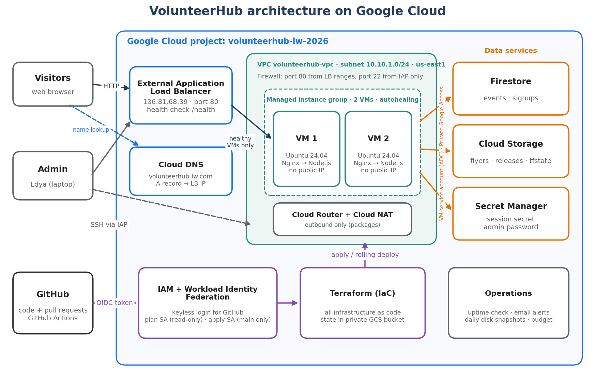

# VolunteerHub

A highly available volunteer sign-up website on **Google Cloud**, built entirely with **Terraform** and delivered through a keyless **GitHub Actions** CI/CD pipeline.

**Live site:** http://volunteerhub-lw.com

*FA2026 Advanced Cloud Computing (MSIT), Project 1, University of Massachusetts Lowell. Author: Ldya Wube.*



## What it does

- Public events page with sign-up forms (park cleanups, blood drives, food bank shifts)
- Password-protected admin page to create events, upload flyer images, and see recent sign-ups
- `/health` endpoint for load balancer health checks and uptime monitoring
- A footer showing which VM served the page, so load balancing is visible in the browser

## Architecture

| Layer | Google Cloud services |
|---|---|
| Entry | Cloud DNS (`volunteerhub-lw.com`), global external Application Load Balancer |
| Compute | Managed instance group with 2 Ubuntu 24.04 VMs (Nginx → Node.js), autohealing, rolling updates |
| Network | Custom VPC, private subnet, firewall rules (load balancer ranges and IAP only), Cloud NAT |
| Data | Firestore (events, sign-ups), Cloud Storage (flyers, releases, Terraform state), Secret Manager |
| Identity | Least-privilege service accounts, Workload Identity Federation for GitHub Actions |
| Operations | Cloud Monitoring uptime check and email alerts, daily disk snapshots, billing budget |

## Repository layout

```
app/                 Node.js / Express website (server.js, public/, seed.js)
infra/               Terraform: network, compute, load balancer, data, IAM, CI/CD, DNS, monitoring
scripts/startup.sh   VM startup script: Node.js 24, systemd service, Nginx reverse proxy
.github/workflows/   terraform-plan.yml, terraform-apply.yml, deploy-app.yml
```

## How changes are delivered

1. **Pull request:** `terraform-plan.yml` logs in to Google Cloud with a **read-only** service account (no keys, via Workload Identity Federation) and runs `fmt`, `validate`, and `plan`.
2. **Merge to `main`:**
   - Infrastructure changes → `terraform-apply.yml` applies the saved plan with a **main-only** service account.
   - App changes → `deploy-app.yml` packages the commit with `git archive`, uploads it as a versioned release, replaces the VMs one at a time (never more than 2), waits until the group is stable, and runs a smoke test through the load balancer.

## Security highlights

- No service account keys anywhere: Application Default Credentials locally, the metadata server on the VMs, and Workload Identity Federation in CI
- VMs have no public IP addresses; SSH only through Identity-Aware Proxy
- Secrets in Secret Manager; the alert email is a GitHub secret marked sensitive in Terraform
- All buckets private (public access prevention and uniform bucket-level access)
- Every change reviewed in a pull request with a Terraform plan

## Future improvements

HTTPS with a Google-managed certificate, a regional instance group with autoscaling, separate dev and prod projects, custom VM images with Packer, and pinned GitHub runner images.
